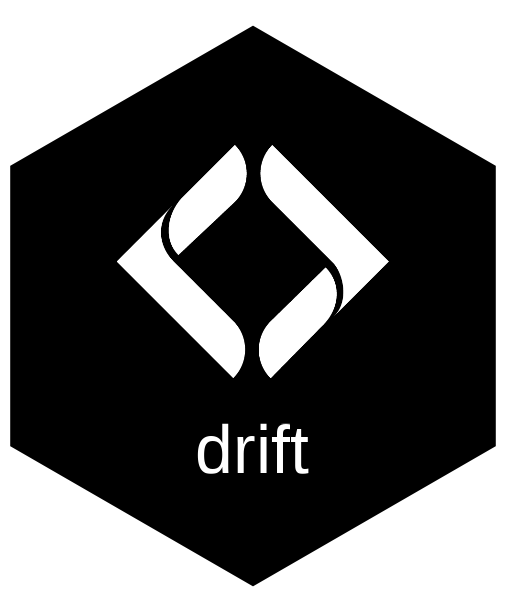
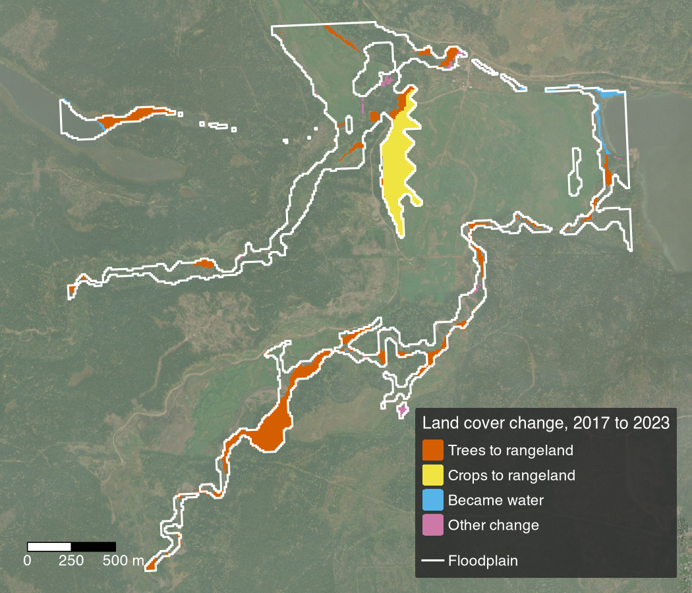

# drift 

<!-- badges: start -->
[](https://lifecycle.r-lib.org/articles/stages.html#experimental)
<!-- badges: end -->

Detecting riparian and inland floodplain transitions: track land cover change within floodplains over time.

drift is an R package that fetches free global land-cover maps, or your own classified rasters, for a floodplain, compares them between two dates and across every year of a series, and turns the change into maps, tables and change polygons. It also fetches dated Sentinel-2 and Esri Wayback imagery to check mapped change against, supports accuracy assessment, and tags change areas with records you supply, such as fire perimeters or cutblocks. The result shows where streamside forest, fields and channels have changed, for restoration planning and for monitoring sites over time.



*Where the mapped land-cover class changed between 2017 and 2023 on a reach of Neexdzii Kwa (Upper Bulkley River), BC, from the data bundled with drift. 34 of the 123 ha mapped changed class; "Other change" lumps the remaining 1.2 ha. Land cover: Esri / Impact Observatory IO LULC. Imagery: Esri World Imagery.*

## Installation

```r
pak::pak("NewGraphEnvironment/drift")
```

The functions that read STAC or Sentinel-2 imagery need [gdalcubes](https://github.com/appelmar/gdalcubes), which was archived on CRAN. Install NewGraphEnvironment's fork, which reports failed reads, even if gdalcubes is already installed. Trajectory break detection also needs bfast.

```r
pak::pak("NewGraphEnvironment/gdalcubes@newgraph")
pak::pak("bfast")
```

drift is under active development and its functions change between releases (see [NEWS](https://www.newgraphenvironment.com/drift/news/index.html)). Pin a release for reproducible work: `pak::pak("NewGraphEnvironment/drift@vX.Y.Z")`.

## Example

Compare 2017 and 2023 on the bundled reach:

```r
library(drift)

d <- system.file("extdata", package = "drift")
lulc <- list(`2017` = terra::rast(file.path(d, "example_2017.tif")),
             `2023` = terra::rast(file.path(d, "example_2023.tif")))
classified <- dft_rast_classify(lulc, source = "io-lulc")
change <- dft_rast_transition(classified, from = "2017", to = "2023")
head(change$summary, 6)
#> # A tibble: 6 × 5
#>   from_class to_class  n_cells  area   pct
#>   <chr>      <chr>       <int> <dbl> <dbl>
#> 1 Trees      Trees        4918 49.2  40.0
#> 2 Rangeland  Rangeland    3026 30.3  24.6
#> 3 Trees      Rangeland    2111 21.1  17.2
#> 4 Crops      Rangeland     998  9.98  8.11
#> 5 Water      Water         938  9.38  7.62
#> 6 Trees      Water          98  0.98  0.8
```

`area` is hectares. For your own area, `dft_stac_fetch()` fetches the land cover for a polygon.

## Learn more

- [Land Cover Change Detection for Floodplains](https://www.newgraphenvironment.com/drift/articles/land-cover-change.html): fetch, classify and compare land cover on the Neexdzii Kwa floodplain, down to single change patches.
- [Trajectories as a Check on Land-Cover Change](https://www.newgraphenvironment.com/drift/articles/trajectory-break-detection.html): a Sentinel-2 vegetation index through time, its abrupt breaks and gradual trends.
- [What a Land-Cover Change Figure Is Made Of](https://www.newgraphenvironment.com/drift/articles/temporal-composition.html): reading every year of a series, not only the two ends.
- [When Did the Floodplain Change?](https://www.newgraphenvironment.com/drift/articles/floodplain-change-dating.html): dating mapped change with Sentinel-2 and Esri Wayback imagery.
- [Function reference](https://www.newgraphenvironment.com/drift/reference/index.html).

## Ecosystem

| Package | Role |
|---------|------|
| [fresh](https://www.newgraphenvironment.com/fresh/) | Stream network modelling engine: segment, classify, cluster, aggregate |
| [link](https://www.newgraphenvironment.com/link/) | Intrinsic habitat models: develop, test and communicate |
| [wet](https://www.newgraphenvironment.com/wet/) | Stream flow and water temperature for BC's Freshwater Atlas |
| [flooded](https://www.newgraphenvironment.com/flooded/) | Delineate floodplain extents from DEMs and stream networks |
| **drift** | Track land cover change within floodplains over time (this package) |
| [floodplains](https://www.newgraphenvironment.com/floodplains/) | Floodplain and land cover change modelling for BC watershed groups |
| [stac_floodplains_bc](https://www.newgraphenvironment.com/stac_floodplains_bc/) | STAC catalogue of floodplain land cover change in BC, 2017-2023, by watershed group |
| [cd](https://www.newgraphenvironment.com/cd/) | Climate departure analysis from ERA5-Land reanalysis |
| [fly](https://www.newgraphenvironment.com/fly/) | Estimate airphoto footprints and select optimal coverage for a study area |
| [gq](https://github.com/NewGraphEnvironment/gq) | Shared map symbology |

## Data and methods it builds on

drift reads Esri / Impact Observatory IO LULC and ESA WorldCover land cover, and Sentinel-2 L2A imagery, from the [Microsoft Planetary Computer](https://planetarycomputer.microsoft.com/) STAC catalogue through [gdalcubes](https://github.com/appelmar/gdalcubes), and dated sub-metre imagery from [Esri World Imagery Wayback](https://livingatlas.arcgis.com/wayback/). Vegetation trajectories default to kNDVI, with abrupt breaks from BFAST Monitor ([bfast](https://cran.r-project.org/package=bfast)) and gradual trends as Theil-Sen slopes with a Mann-Kendall test. Accuracy and error-adjusted area follow Olofsson et al. (2014) and Stehman (2014), through [mapaccuracy](https://cran.r-project.org/package=mapaccuracy).

## Citation and license

Cite drift with `citation("drift")`, or from [CITATION.cff](https://github.com/NewGraphEnvironment/drift/blob/main/CITATION.cff). MIT licensed; see [LICENSE](https://www.newgraphenvironment.com/drift/LICENSE.html).
