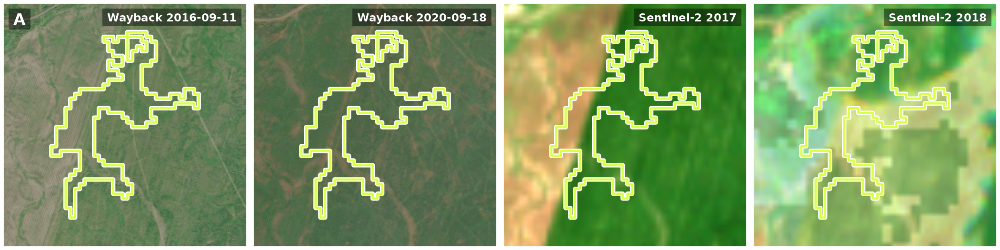
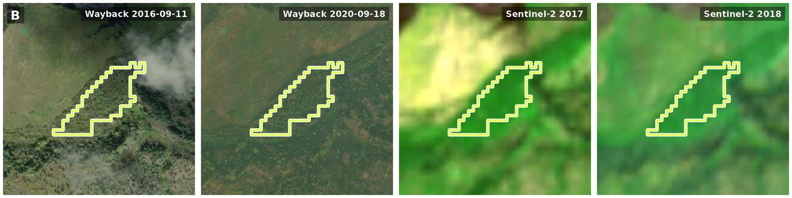
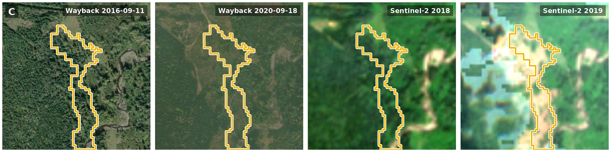
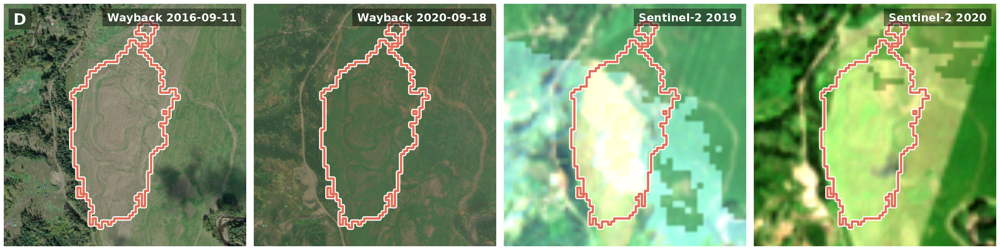
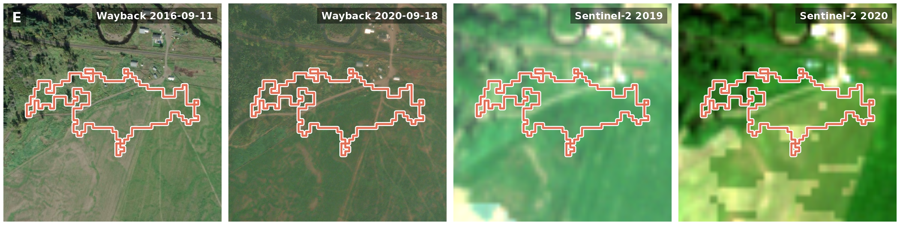
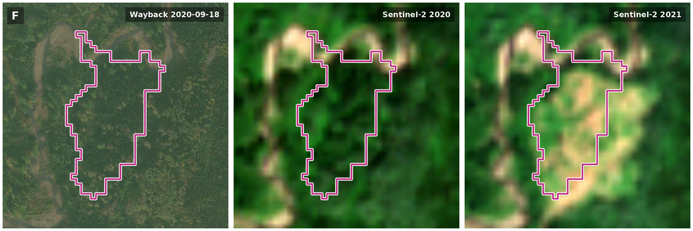
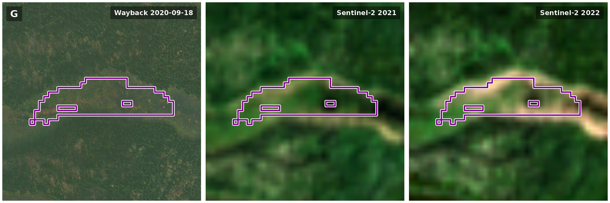
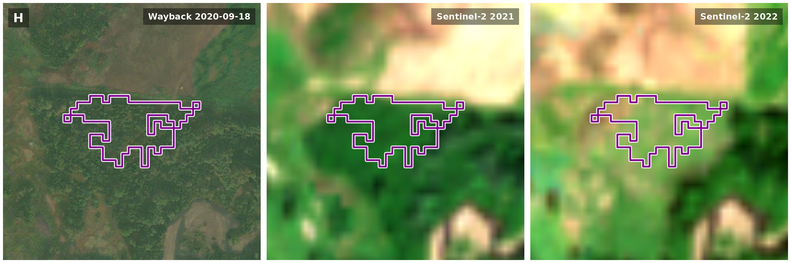
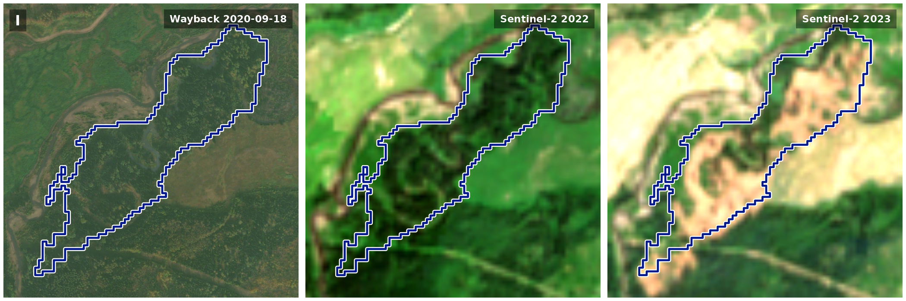
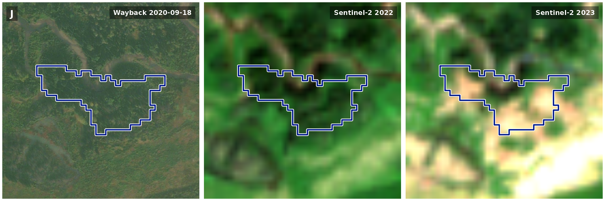

# When Did the Floodplain Change? Dating Detected Change with Sentinel-2 and Esri Wayback

drift finds where a floodplain’s land cover changed, and dates it. This
article follows that change through one 3.3 × 3.2 km box of floodplain
in the Bulkley River watershed group, northern British Columbia, where
most of the change lies along Maxan Creek and Crow Creek. It then looks
at each change with drift’s two imagery tools: sharp Esri Wayback images
where they exist, and a Sentinel-2 image of every summer. The sharp
images say what changed; here they stop in 2020, so the later changes
are seen only in Sentinel-2.

Code

``` r

op <- par(mar = c(0, 0, 0, 0), bg = "white")
plotRGB(relief, scale = 255, mar = NA, axes = FALSE)
bulk_v <- ctx_v("bulk")
# outside the watershed group is dimmed
frame_v <- as.polygons(ext(relief), crs = crs(relief))
plot(erase(frame_v, bulk_v), add = TRUE, col = adjustcolor("white", 0.5), border = NA)
plot(ctx_v("floodplain"), add = TRUE, col = adjustcolor(fp_col, 0.75), border = NA)
lines(bulk_v, col = "grey20", lwd = 1.5)
river_v <- ctx_v("river")
lines(river_v, col = "#1F4E79", lwd = 1.2)
towns_v <- ctx_v("town")
points(towns_v, pch = 21, bg = "white", col = "grey10", cex = 0.8)
text(towns_v, ctx$name[ctx$part == "town"], pos = 4, offset = 0.4, cex = 0.75,
     col = "grey10", halo = TRUE, hc = "white")
# the river is labelled on its reach between Smithers and New Hazelton, clear of the
# study area
town_xy <- crds(towns_v)[ctx$name[ctx$part == "town"] %in% c("Smithers", "New Hazelton"), ]
river_pts <- crds(river_v)
near <- which.min(colSums((t(river_pts) - colMeans(town_xy))^2))
text(vect(river_pts[near, , drop = FALSE], crs = crs(relief)), "Bulkley River", font = 3,
     cex = 0.8, col = "#1F4E79", pos = 4, offset = 0.6, halo = TRUE, hc = "white")
# the box is a few pixels at this scale, so it is ringed as well
box_xy <- crds(centroids(ctx_v("box")))
points(box_xy, pch = 22, cex = 1.1, col = "red", bg = "red")
points(box_xy, pch = 1, cex = 3.5, col = "white", lwd = 4)
points(box_xy, pch = 1, cex = 3.5, col = "red", lwd = 2)
w <- xmax(relief) - xmin(relief)
text(vect(box_xy + c(-0.035, 0.02) * w, crs = crs(relief)), "Study area", adj = c(1, 0),
     font = 2, cex = 0.9, col = "red", halo = TRUE, hc = "white")
# Web Mercator stretches distance by 1 / cos(latitude)
k <- cos(mean(ext(project(ctx_v("box"), "EPSG:4326"))[3:4]) * pi / 180)
sbar(20000 / k, "topleft", type = "bar", divs = 2, below = "km", scaleby = 1000 / k,
     cex = 0.8)
legend("bottomleft", legend = c("Bulkley watershed group", "Floodplain", "Study area"),
       col = c("grey20", adjustcolor(fp_col, 0.75), "red"), lwd = c(1.5, NA, NA),
       pch = c(NA, 15, 22), pt.bg = c(NA, NA, "red"), pt.cex = c(NA, 1.8, 1.1),
       bg = "white", cex = 0.8, inset = 0.02)
# BC inset
par(fig = c(0.74, 0.98, 0.74, 0.98), new = TRUE, mar = c(0, 0, 0, 0))
bc_v <- ctx_v("bc")
plot(bc_v, col = "grey92", border = "grey45", axes = FALSE, mar = c(0, 0, 0, 0),
     background = "white", box = TRUE)
plot(ctx_v("bulk_bc"), add = TRUE, col = "red", border = NA)
```

![The box in the Bulkley River watershed group, northern British
Columbia. Blue is the watershed group's floodplain and the darker line
the Bulkley River; ground outside the group is dimmed, and the inset
shows the group in the province. The scale bar is 20 km at the box's
latitude. Basemap: Esri World Light Gray Base (Esri, HERE, Garmin, (c)
OpenStreetMap contributors, and the GIS user community); Esri World
Hillshade (Esri, Vantor, Airbus DS, USGS, NGA, NASA, CGIAR, N Robinson,
NCEAS, NLS, OS, NMA, Geodatastyrelsen, Rijkswaterstaat, GSA, Geoland,
FEMA, Intermap, and the GIS user
community).](floodplain-change-dating_files/figure-html/fig-context-1.png)

The box in the Bulkley River watershed group, northern British Columbia.
Blue is the watershed group’s floodplain and the darker line the Bulkley
River; ground outside the group is dimmed, and the inset shows the group
in the province. The scale bar is 20 km at the box’s latitude. Basemap:
Esri World Light Gray Base (Esri, HERE, Garmin, (c) OpenStreetMap
contributors, and the GIS user community); Esri World Hillshade (Esri,
Vantor, Airbus DS, USGS, NGA, NASA, CGIAR, N Robinson, NCEAS, NLS, OS,
NMA, Geodatastyrelsen, Rijkswaterstaat, GSA, Geoland, FEMA, Intermap,
and the GIS user community).

Code

``` r

par(op)
```

drift finds 10 change areas in the box, lettered A to J on the map in
the next section: patches of 1 ha or more where neighbouring floodplain
cells switched land cover in the same year and stayed. Sharp images from
before and after reach 5 of them, and show only C as a change: A, B, D,
E are class errors, where the land-cover map gave the same ground a
different class. The 5 areas dated after 2020 have no sharp image after
their change, only Sentinel-2: F, H, I, J look like forest opening up,
and G is unclear.

## What changed in this floodplain, and when?

The floodplain and its land cover are a published STAC item,
bulk_all_ff04 (processed 2026-10-14 with drift 0.20.0 and flooded
0.7.0): the floodplain polygon, and Impact Observatory’s 10 m land cover
for every year from 2017 to 2023, clipped to it. The item is in the
[stac_floodplains_bc](https://www.newgraphenvironment.com/stac_floodplains_bc/)
catalogue, and the modelling that made it is in
[floodplains](https://www.newgraphenvironment.com/floodplains/).
[`dft_rast_break_class()`](https://www.newgraphenvironment.com/drift/reference/dft_rast_break_class.md)
reads the seven years in each cell and finds the year its class
switched, and
[`dft_rast_break_category()`](https://www.newgraphenvironment.com/drift/reference/dft_rast_break_category.md)
says whether the switch held.

Code

``` r

library(drift)
crs <- "EPSG:32609"
bbox <- c(xmin = -126.17545256019142, ymin = 54.36161045287439,
          xmax = -126.12615394008702, ymax = 54.38908432381547)
aoi <- sf::st_bbox(bbox, crs = 4326) |>
  sf::st_as_sfc() |>
  sf::st_transform(crs) |>
  sf::st_bbox() |>   # the box's UTM rectangle, so rasters are full rectangles
  sf::st_as_sfc() |>
  sf::st_as_sf()


item <- rstac::stac("https://images.a11s.one") |>
  rstac::collections("stac-floodplains-bc") |>
  rstac::items("bulk_all_ff04") |>
  rstac::get_request()
href <- function(asset) item$assets[[asset]]$href


fp <- sf::st_read(href("floodplain"), layer = "all_ff04", quiet = TRUE) |>
  sf::st_transform(crs)


years <- 2017:2023
landcover <- lapply(years, function(y) {
  r <- terra::rast(paste0("/vsicurl/", href(paste0("classified_", y))))
  terra::crop(r, terra::vect(aoi))
})
names(landcover) <- years


bc <- dft_rast_break_class(landcover)
category <- dft_rast_break_category(bc)
```

The figures below read the small files that script saved, so the page
itself makes no network call.

Code

``` r

# The figures read the files data-raw/floodplain_change_dating.R saved;
# nothing here goes to the network. s2_view is
# the composites as 8-bit display bytes on one stretch, and change.tif holds a
# clean switch's year less 2000.
library(terra)
d <- function(f) file.path("floodplain-change-dating", f)
crs <- "EPSG:32609"

item <- utils::read.csv(d("item.csv"))
summ <- utils::read.csv(d("summary.csv"))
areas <- utils::read.csv(d("areas.csv"), na.strings = "")
caps <- utils::read.csv(d("captures.csv"))
caps$capture_date <- as.Date(caps$capture_date)
sharp <- caps[caps$res_m < 1, ]
newest <- max(sharp$capture_date)
newest_first <- as.Date(sharp$release_first[sharp$capture_date == newest])
newest_last <- as.Date(sharp$release_last[sharp$capture_date == newest])
fmt <- function(x) format(as.Date(x), "%Y-%m-%d")
yr <- function(x) format(as.Date(x), "%Y")

change <- rast(d("change.tif"))
box_km <- round(c(xmax(change) - xmin(change), ymax(change) - ymin(change)) / 1000, 1)
asp <- (ymax(change) - ymin(change)) / (xmax(change) - xmin(change))
years <- 2017:2023
s2_view <- setNames(lapply(years, function(y) rast(d(paste0("s2_", y, ".tif")))), years)

fpc <- utils::read.csv(d("floodplain.csv"))
fp_edge <- vect(fpc$wkt[fpc$part == "edge"], crs = crs)
area_v <- vect(areas$wkt, crs = crs)
relief <- rast(d("relief_bulk.tif"))
relief_credit <- readLines(d("relief_credit.txt"))
ctx <- utils::read.csv(d("context.csv"))
ctx_v <- function(part) vect(ctx$wkt[ctx$part == part], crs = ctx$crs[ctx$part == part][1])
# ground outside the floodplain is dimmed, so the floodplain reads as the subject
outside <- ifel(is.na(change), 1, NA)

# What the imagery shows in each area was read off the panels below. It is tied
# to the areas it was read for, so a rerun that changes them stops the build
# rather than putting a verdict on the wrong area.
seen_by_eye <- data.frame(
  key = c("A 2018 Crops Rangeland", "B 2018 Rangeland Trees", "C 2019 Trees Rangeland",
          "D 2020 Crops Rangeland", "E 2020 Crops Rangeland", "F 2021 Trees Rangeland",
          "G 2022 Trees Rangeland", "H 2022 Trees Crops", "I 2023 Trees Rangeland",
          "J 2023 Trees Rangeland"),
  shows = c("Part of one open meadow; its western arm crosses the strip mown in 2016",
            "The same stand of trees before and after",
            "Creekside forest opened up",
            "Part of the same meadow; mown in 2016, grassed in 2020",
            "Part of the same meadow, running into a farmyard; its southern lobe crosses the strip mown in 2016",
            "Forest in 2020, then brightens in 2021",
            "An open wet meadow along a channel in 2020, then brightens over 2021 and 2022",
            "Forest in 2020, then brightens in 2022",
            "Forest in 2020, then opens up in 2023",
            "Forest in 2020, then opens up in 2023"),
  ground = c("Class error", "Class error", "Change", "Class error", "Class error",
             "Likely change", "Unclear", "Likely change", "Likely change", "Likely change")
)
if (!identical(paste(areas$id, areas$year, areas$from, areas$to), seen_by_eye$key)) {
  stop("areas.csv has changed: look at the panels again before reusing the verdicts")
}
areas$shows <- seen_by_eye$shows
areas$ground <- seen_by_eye$ground
by_ground <- function(g) areas$id[areas$ground == g]

# A Google Maps satellite link at a point inside each area. Google does not say
# when its image was taken, so it is an undated look at the ground, not a date.
ll <- crds(project(vect(cbind(areas$lab_x, areas$lab_y), crs = crs), "EPSG:4326"))
areas$google <- sprintf(
  "https://www.google.com/maps/@?api=1&map_action=map&center=%.5f,%.5f&zoom=17&basemap=satellite",
  ll[, 2], ll[, 1])

# Sentinel-2 brightening: each area's mean display value less the year before,
# less the same for the whole box, for every year. Forest is dark, so a patch
# opened to grass or bare ground brightens more than the box does that year.
s2_grey <- lapply(s2_view, mean)
box_mean <- vapply(s2_grey, function(r) global(r, "mean")[[1]], 1)
area_mean <- t(vapply(seq_len(nrow(areas)), function(a) {
  vapply(s2_grey, function(r) extract(r, area_v[a], fun = mean)[1, 2], 1)
}, numeric(length(years))))
rise <- t(apply(area_mean, 1, diff)) - matrix(diff(box_mean), nrow(areas), length(years) - 1,
                                              byrow = TRUE)
colnames(rise) <- years[-1]
areas$rise <- rise[cbind(seq_len(nrow(areas)), match(areas$year, years[-1]))]
areas$brightens <- areas$rise > 0
# the year of an area's largest rise against the box
areas$rise_year <- as.integer(colnames(rise)[apply(rise, 1, which.max)])

seen <- which(!is.na(areas$wb_before) & !is.na(areas$wb_after))
s2_only <- which(is.na(areas$wb_after) & !is.na(areas$wb_before))
# "in one summer": the mapped year's rise is more than twice any other year's;
# "over two summers": G rises in the year before its mapped year as well
one_summer <- vapply(seq_len(nrow(areas)), function(a) {
  r <- rise[a, ]
  k <- as.character(areas$year[a])
  r[[k]] > 2 * max(r[names(r) != k])
}, logical(1))
stopifnot(length(seen) + length(s2_only) == nrow(areas),
          setequal(c(by_ground("Change"), by_ground("Class error")), areas$id[seen]),
          setequal(c(by_ground("Likely change"), by_ground("Unclear")), areas$id[s2_only]),
          all(as.Date(areas$wb_before[s2_only]) == newest),
          all(one_summer[areas$id %in% c("F", "H", "I", "J")]), !one_summer[areas$id == "G"],
          with(list(r = rise[areas$id == "G", ]),
               min(r[c("2021", "2022")]) > 2 * max(abs(r[!names(r) %in% c("2021", "2022")]))),
          all(areas$rise_year[s2_only] == areas$year[s2_only]),
          areas$brightens[areas$id == "A"],
          all(areas$wb_before[seen] == areas$wb_before[seen[1]]),
          all(as.Date(areas$wb_after[seen]) == newest),
          all(areas$cutblock_share[areas$id != "I"] < 0.1),
          areas$cutblock_share[areas$id == "I"] >= 0.1,
          !is.na(areas$cutblock_year[areas$id == "I"]),
          names(which.max(box_mean)) == "2019")

# Colours: the floodplain edge from the gq registry's floodplain style, and one
# colour per change year; grey is change that never settled.
reg <- gq::gq_reg_main()
fp_col <- reg$layers$floodplains$fill$color
yr_set <- 2018:2023
yr_col <- setNames(hcl.colors(length(yr_set), "Plasma", rev = TRUE), yr_set)
grey_col <- grey(0.55)

draw_fp <- function(lwd = 1.5) {
  lines(fp_edge, col = "white", lwd = lwd + 1.5)
  lines(fp_edge, col = fp_col, lwd = lwd)
}
draw_area <- function(a, lwd = 1.5) {
  lines(area_v[a], col = "white", lwd = lwd + 1.5)
  lines(area_v[a], col = yr_col[as.character(areas$year[a])], lwd = lwd)
}
# white text on a dark band, so it reads over pale ground too
panel_label <- function(lab, right = FALSE, cex = 0.8) {
  u <- par("usr")
  pad <- 0.02 * (u[2] - u[1])
  x <- if (right) u[2] - 2 * pad else u[1] + 2 * pad
  y <- u[4] - 2 * pad
  w <- strwidth(lab, cex = cex, font = 2)
  h <- strheight(lab, cex = cex, font = 2)
  x0 <- if (right) x - w else x
  rect(x0 - pad, y - h - pad, x0 + w + pad, y + pad, col = adjustcolor("black", 0.45),
       border = NA)
  text(x0, y, lab, adj = c(0, 1), font = 2, col = "white", cex = cex)
}
view_ext <- function(a) {
  ext(unlist(areas[a, c("view_xmin", "view_xmax", "view_ymin", "view_ymax")]))
}
wb_view <- function(a, date) rast(d(paste0("wb_", areas$id[a], "_", date, ".tif")))

# One row of panels per area, each panel the area's view in one image, headed
# by a line with the area's Google Maps link so the two can be compared
area_rows <- function(rows, panels) {
  for (a in rows) {
    cat("\n\n**", areas$id[a], "** · ", areas$year[a], " · ", areas$from[a], " to ",
        areas$to[a], " · ", areas$ground[a], " · [Google Maps](", areas$google[a],
        "){target=\"_blank\"}\n\n", sep = "")
    op <- par(mfrow = c(1, length(panels)), mar = c(0.2, 0.2, 0.2, 0.2), bg = "white")
    for (k in seq_along(panels)) {
      plotRGB(panels[[k]]$img(a), scale = 255, mar = NA, axes = FALSE, ext = view_ext(a))
      draw_area(a)
      panel_label(panels[[k]]$label(a), right = TRUE, cex = 0.7)
      if (k == 1) panel_label(areas$id[a], cex = 1)
    }
    par(op)
  }
}
s2_panel <- function(offset) {
  list(img = function(a) s2_view[[as.character(areas$year[a] + offset)]],
       label = function(a) paste("Sentinel-2", areas$year[a] + offset))
}
wb_panel <- function(which) {
  list(img = function(a) wb_view(a, areas[[which]][a]),
       label = function(a) paste("Wayback", areas[[which]][a]))
}
```

Code

``` r

op <- par(mar = c(0, 0, 0, 0), bg = "white")
plotRGB(s2_view[[length(s2_view)]], scale = 255, mar = NA, axes = FALSE)
plot(outside, add = TRUE, col = "white", alpha = 0.45, legend = FALSE, axes = FALSE)
# change.tif stores a switch year less 2000, 1 for never settled, 0 and 2 for
# no lasting change, and NA outside the floodplain
yr_layer <- classify(change, rbind(c(0, NA), c(2, NA)))
coltab(yr_layer) <- data.frame(value = c(1, yr_set - 2000), col = c(grey_col, yr_col))
plot(yr_layer, add = TRUE, legend = FALSE, axes = FALSE, alpha = 0.85)
draw_fp(1.2)
text(vect(cbind(areas$lab_x, areas$lab_y), crs = crs), areas$id,
     col = "black", font = 2, cex = 0.8, halo = TRUE, hc = "white")
sbar(500, "topleft", type = "bar", divs = 2, below = "", label = "", col = "white")
legend("bottomright", legend = c(yr_set, "never settled"), fill = c(yr_col, grey_col),
       border = NA, bg = "white", cex = 0.75, ncol = 2, inset = 0.02)
```


Floodplain cells by the year their land cover switched and stayed
switched, over the 2023 Sentinel-2 image. Grey cells changed but never
settled on one class. Uncoloured floodplain cells either kept their
class or flickered and came back to it. Ground outside the floodplain is
dimmed. Letters name the change areas of 1 ha or more. The blue line is
the edge of the floodplain; the scale bar is 500 m.

Code

``` r

par(op)
```

Grey is change that never settled, and this article sets it aside, along
with the cells that flickered and came back. The coloured cells switched
once and stayed, which gives each a date. A date from a 10 m map is a
place to look, though, not yet a change on the ground, so each lettered
area is looked at below.

## What does drift give us to look with?

| Tool | What it gives |
|:---|:---|
| [`dft_rast_break_class()`](https://www.newgraphenvironment.com/drift/reference/dft_rast_break_class.md), [`dft_rast_break_category()`](https://www.newgraphenvironment.com/drift/reference/dft_rast_break_category.md) | The year each cell’s land cover switched, and whether it held |
| [`dft_stac_composite()`](https://www.newgraphenvironment.com/drift/reference/dft_stac_composite.md) | A Sentinel-2 image of every summer, at 10 m |
| [`dft_wayback_captures()`](https://www.newgraphenvironment.com/drift/reference/dft_wayback_captures.md), [`dft_wayback_pick()`](https://www.newgraphenvironment.com/drift/reference/dft_wayback_pick.md), [`dft_wayback_fetch()`](https://www.newgraphenvironment.com/drift/reference/dft_wayback_fetch.md) | Sharp (under 1 m) images where Esri holds them, but only from the days its providers imaged the place |

drift’s tools for dating change and looking at it. {.table}

[`dft_stac_composite()`](https://www.newgraphenvironment.com/drift/reference/dft_stac_composite.md)
reads Sentinel-2 from Microsoft’s Planetary Computer. For each summer it
takes the June and July scenes with under 20% cloud, masks cloud and
snow, and keeps the median of each band. The panels share one display
stretch, so a difference in brightness between them is in the data, not
the display. A composite can still carry pale patches: the 2019 image is
the palest of the seven.

Code

``` r

s2 <- dft_stac_composite(aoi, years = years, months = 6:7, crs = crs)
```

Esri Wayback keeps the versions of Esri’s World Imagery basemap released
since 2014. Each version, a *release*, is a mosaic of images taken on
many days, so drift reads which *capture* (the day an image was taken)
each release draws over the box, then picks and fetches by capture.

Code

``` r

releases <- dft_wayback_releases()
releases <- releases[releases$release_date >= as.Date("2015-01-01") &
                       releases$release_date <= as.Date("2026-10-15"), ]
captures <- dft_wayback_captures(aoi, zoom = 16:18, releases = releases)

# A polygon pick prefers the later release among equally near captures, and cover
# only breaks ties, so keep for each capture only the releases where it covers as
# much of the box as it ever does (research/esri-wayback.md, "Picking for a polygon").
best <- stats::ave(captures$cover, captures$capture_date, FUN = max)
sharp <- captures[captures$res_m < 1 & captures$cover >= best - 0.001, ]
sharp_dates <- sort(unique(sharp$capture_date))
picks <- dft_wayback_pick(sharp, as.Date(paste0(format(sharp_dates, "%Y"), "-07-01")))

chips <- lapply(seq_len(nrow(picks)), function(i) {
  dft_wayback_fetch(aoi, picks$release_id[i], picks$zoom[i], crs = crs, res = 0.5)
})
names(chips) <- format(picks$capture_date)
```

## What do the sharp images show?

For the 5 areas dated 2018 to 2020, Wayback has a sharp image from
before the change (2016-09-11) and one from 2020-09-18, after the change
or, for the areas dated 2020, late in its year.

Each row below is one area: Wayback before the change and at its end or
after it, then Sentinel-2 the summer before and the summer of the
change. The outline is the area, in the colour of its year, and the link
above each row opens Google’s satellite image of it, which Google does
not date.

Code

``` r

area_rows(seen, list(wb_panel("wb_before"), wb_panel("wb_after"), s2_panel(-1), s2_panel(0)))
```

**A** · 2018 · Crops to Rangeland · Class error · [Google
Maps](https://www.google.com/maps/@?api=1&map_action=map&center=54.38290,-126.14204&zoom=17&basemap=satellite)



**B** · 2018 · Rangeland to Trees · Class error · [Google
Maps](https://www.google.com/maps/@?api=1&map_action=map&center=54.36865,-126.14757&zoom=17&basemap=satellite)



**C** · 2019 · Trees to Rangeland · Change · [Google
Maps](https://www.google.com/maps/@?api=1&map_action=map&center=54.36433,-126.17020&zoom=17&basemap=satellite)



**D** · 2020 · Crops to Rangeland · Class error · [Google
Maps](https://www.google.com/maps/@?api=1&map_action=map&center=54.38114,-126.14539&zoom=17&basemap=satellite)



**E** · 2020 · Crops to Rangeland · Class error · [Google
Maps](https://www.google.com/maps/@?api=1&map_action=map&center=54.38504,-126.14104&zoom=17&basemap=satellite)



Only C is a change on the ground. The forest along Maxan Creek has
opened up by 2020. A, D and E are parts of one open meadow, which the
land-cover map moved from Crops to Rangeland; where it was mown in 2016,
across D and parts of A and E, it is grassed over by 2020, a change of
use at most. B is the same stand of trees in both. Sentinel-2 alone
would not have shown this: in its year A brightens more than the box as
a whole does, just as a cleared patch would.

## What changed after 2020?

For the 5 areas dated 2021 to 2023, the last sharp image is the one from
2020-09-18. It shows F, H, I and J as forest, and G as an open wet
meadow along a channel.

Each row is one area: the last sharp Wayback image (2020-09-18), then
Sentinel-2 the summer before and the summer of the change.

Code

``` r

area_rows(s2_only, list(wb_panel("wb_before"), s2_panel(-1), s2_panel(0)))
```

**F** · 2021 · Trees to Rangeland · Likely change · [Google
Maps](https://www.google.com/maps/@?api=1&map_action=map&center=54.36433,-126.16473&zoom=17&basemap=satellite)



**G** · 2022 · Trees to Rangeland · Unclear · [Google
Maps](https://www.google.com/maps/@?api=1&map_action=map&center=54.38503,-126.16754&zoom=17&basemap=satellite)



**H** · 2022 · Trees to Crops · Likely change · [Google
Maps](https://www.google.com/maps/@?api=1&map_action=map&center=54.36705,-126.16762&zoom=17&basemap=satellite)



**I** · 2023 · Trees to Rangeland · Likely change · [Google
Maps](https://www.google.com/maps/@?api=1&map_action=map&center=54.36925,-126.15777&zoom=17&basemap=satellite)



**J** · 2023 · Trees to Rangeland · Likely change · [Google
Maps](https://www.google.com/maps/@?api=1&map_action=map&center=54.37185,-126.14612&zoom=17&basemap=satellite)



Of the six years, each area brightens most, against the box as a whole,
in the year the map gives it. For F, H, I and J that is forest opening
up in one summer, which bears the date out. G brightens over two summers
and was already open in 2020, so the map’s switch from Trees there may
be a label catching up with what was on the ground. Part of I lies in a
cutblock the province records as harvested from 2023, and none of the
others lies mostly in one. What happened in F, G, H and J cannot be told
at 10 m: a cut, a slide and a channel moving would all look alike.

## Why do the sharp images stop in 2020?

Wayback can show only what Esri’s providers imaged and Esri released.
Over this box, the releases from 2015 on draw 3 sharp captures at the
zoom levels read (16 to 18), from 2014-06-01, 2016-09-11, 2020-09-18.
The newest is still the one drawn by every release from 2022-05-18 to
2026-09-24, the latest. Nothing newer has been released here, so a
change after 2020 has no sharp image yet. Sentinel-2 images every
summer, but at 10 m.

## The numbers

| Area | Year | Land cover | On the ground | What the imagery shows | ha | Cutblock |
|:---|---:|:---|:---|:---|---:|:---|
| A | 2018 | Crops to Rangeland | Class error | Part of one open meadow; its western arm crosses the strip mown in 2016 | 3.27 |  |
| B | 2018 | Rangeland to Trees | Class error | The same stand of trees before and after | 1.14 |  |
| D | 2020 | Crops to Rangeland | Class error | Part of the same meadow; mown in 2016, grassed in 2020 | 13.49 |  |
| E | 2020 | Crops to Rangeland | Class error | Part of the same meadow, running into a farmyard; its southern lobe crosses the strip mown in 2016 | 3.90 |  |
| C | 2019 | Trees to Rangeland | Change | Creekside forest opened up | 5.79 |  |
| F | 2021 | Trees to Rangeland | Likely change | Forest in 2020, then brightens in 2021 | 3.57 |  |
| H | 2022 | Trees to Crops | Likely change | Forest in 2020, then brightens in 2022 | 1.09 |  |
| I | 2023 | Trees to Rangeland | Likely change | Forest in 2020, then opens up in 2023 | 13.45 | 27% in a 2023 block |
| J | 2023 | Trees to Rangeland | Likely change | Forest in 2020, then opens up in 2023 | 1.92 |  |
| G | 2022 | Trees to Rangeland | Unclear | An open wet meadow along a channel in 2020, then brightens over 2021 and 2022 | 1.81 |  |

The change areas, class errors first. On the ground is what the imagery
shows: a change or a class error where Wayback has sharp images from
before and after, and a likely change or unclear where only Sentinel-2
does. Cutblock is the share of the area inside a BC consolidated
cutblock, with the block’s harvest start year, where that is 10% or
more. Across the box, the floodplain’s 10 m cells hold 209 ha with no
change, 68.3 ha that switched once and stayed, 52.7 ha that changed and
never settled, and 63.6 ha that flickered and came back to its first
class. {.table}

## Limits

- A clean switch is a date to look at, not a confirmed change: the
  land-cover map moves unchanged ground between similar classes, as it
  moved one meadow here from Crops to Rangeland.
- A switch in 2018 or 2023 rests on a single year of land cover on one
  side of it.
- Wayback shows only what Esri has released, and here nothing after
  2020-09-18; the 2016-09-11 capture covers only part of the box.
- Sentinel-2 at 10 m shows the year ground brightened. Where forest
  opened up, that bears out the map’s date, but a meadow brightens in
  years its cover did not change, as A, D and E do. It cannot say what
  happened, and a composite can carry pale patches.
